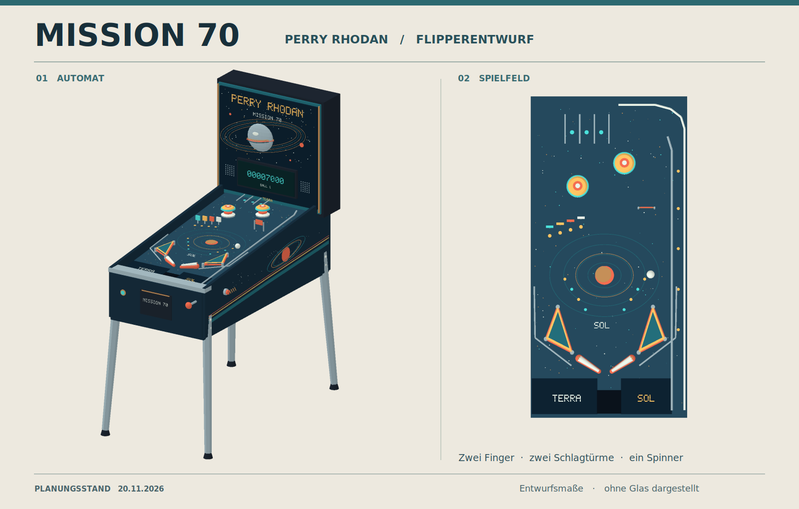

# Flipper Bauplan

Wir bauen einen klassischen Flipper mit echter Kugel als Geschenk zum **70. Geburtstag am 12. November 2027**.

**Thema: Perry Rhodan.** Gehäuse, Spielfeld und Spielregeln sollen ein persönliches Weltraumabenteuer ergeben.

## Aktueller Plan

- Zwei elektrisch betätigte Flipperfinger, zwei Schlagtürme und zwei seitliche Schlagarme.
- Eine Kugel im Spiel, manueller Abschuss und automatische Kugelrückführung.
- Feste Ziele, Spinner und Bahnen sowie Licht, Ton und eine kleine Punkteanzeige.
- Holz und Mechanik in Eigenleistung; fertige Steuerungsplatinen und fachkundige Unterstützung für den elektrischen Aufbau.
- Vorläufiger Kostenansatz **rund 5.200 € einschließlich 20 % Reserve**. Der Betrag ist noch keine Budgetfestlegung.

Die Ausstattung ist ein Vorschlag. Bestätigt sind die echte Kugel, das Thema und der Geburtstag.

## Planungsunterlagen

- [Bauumfang, Kosten und Zeitplan](docs/bauplan.md)
- [Grobe Stückliste als CSV](planung/stueckliste.csv)
- [Einkaufsliste mit Testbrett und Ausbau](planung/einkaufsliste.md) · [Excel-Datei](planung/Einkaufsliste.xlsx)
- [Drehbares 3D-Modell als HTML-Datei](modell/Mission-70-3D.html) – herunterladen und im Browser öffnen.

Das Modell zeigt Gehäuse und Spielfeld mit schematischer Mechanik. Bohrungen, Anschlüsse und endgültige Maße ergeben sich aus der Passprobe mit den Originalteilen.

Stand der Preisrecherche: 20. November 2026. Die grobe Stückliste enthält Budgetansätze. Die konkrete Einkaufsliste führt Händlerpreise in Euro und US-Dollar und markiert die noch offenen Entscheidungen bei Stromversorgung und Kugeltruhe.
